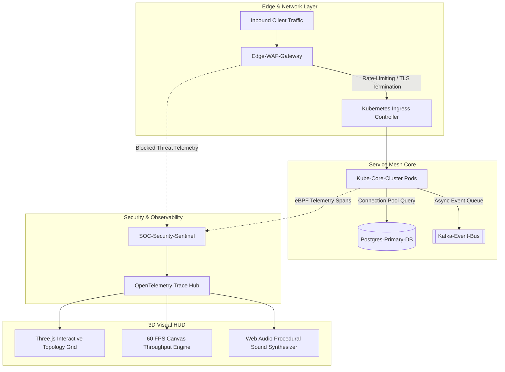

# 🌐 NetPulse-3D // Cloud Network Topology & SRE Observability HUD

[](https://MarcosAosf.github.io/netpulse-3d/)
[](https://threejs.org/)
[](https://developer.mozilla.org/)
[](https://opentelemetry.io/)
[](LICENSE)

> **Real-time 3D cloud infrastructure topology and SRE observability cockpit for Kubernetes service meshes, edge gateways, and SOC security telemetry.**  
> *Engineered with Three.js WebGL rendering, 60 FPS Canvas throughput graph, Web Audio API procedural synthesizer, and modular Vanilla ES6 architecture for instant deployment to GitHub Pages.*

---

## 📸 Interface Architecture

```
┌────────────────────────────────────────────────────────────────────────────────────────┐
│  NETPULSE-3D  │ STATUS: HEALTHY (99.98%) │ RPS: 1,420 req/s │ P95: 2.4ms │ MITIGATED: 14 │
├──────────────────────────┬───────────────────────────────┬─────────────────────────────┤
│ 3D CLUSTER MESH TOPOLOGY │ TRAFFIC THROUGHPUT ENGINE     │ DISTRIBUTED OPENTELEMETRY   │
│                          │                               │                             │
│   [ Three.js WebGL ]     │      [ 60 FPS Canvas ]        │ [14:35:10] Ingress ➔ Kube:  │
│      K8s Core Node       │   Real-time RPS & Latency     │ >> GET /api/v1/auth (1.8ms) │
│       /\        /\       │   Interactive Gradient Curve  │                             │
│      /  \      /  \      │                               │ [14:35:12] WAF ➔ SOC:       │
│  Ingress  DB   Kafka     │───────────────────────────────│ >> 403_BLOCKED (SQLi Drop)  │
│                          │ SRE INCIDENT & ALERT FEED     │                             │
│ ──────────────────────── │ [OK] K8s HPA: 24 Replicas     │ [14:35:14] Kube ➔ Kafka:    │
│ Pods: 24/24 | eBPF: OK   │ [WARN] DB Mem pressure (78%)  │ >> Produced audit event     │
└──────────────────────────┴───────────────────────────────┴─────────────────────────────┘
```

---

## 🏛️ System Architecture



---

## ⚡ Key Technical Capabilities

1. **Three.js WebGL Service Mesh Topology:**
   - Real-time rotating 3D infrastructure nodes representing Cloud Ingress, Kubernetes Service Mesh, Database Clusters, Message Brokers, and SOC Engines.
   - Interactive mouse raycasting: hover and click on any infrastructure node to trigger localized packet pings.
   - Animated glowing network vectors with particle flows representing live microservice transactions.

2. **Ultra-Fast 60 FPS Canvas Telemetry Engine:**
   - Zero-dependency canvas engine plotting real-time Request-Per-Second (RPS) throughput curves and P95/P99 latency fluctuations.

3. **OpenTelemetry Distributed Tracing Stream:**
   - Emulates distributed spans (HTTP/2, gRPC, TCP, Kafka) with latency measurements, payload sizes, and status codes.
   - Live category filter pills and interactive JSON inspection modal.

4. **Web Audio API Procedural Synthesizer:**
   - Generates authentic network ping blips and multi-tone warning sirens for critical security incidents without external `.wav`/`.mp3` files.

5. **Pure Vanilla Web Architecture:**
   - Zero build step (`npm run build` not required).
   - Deploys instantly to GitHub Pages or any static CDN.

---

## 💻 Local Quickstart

```bash
# Clone the repository
git clone https://github.com/MarcosAosf/netpulse-3d.git
cd netpulse-3d

# Run with Python built-in server
python -m http.server 8080
```
Open your browser at: `http://localhost:8080`

---

## 🌐 Deploy to GitHub Pages

1. Push this repository to GitHub.
2. In your repository on GitHub, navigate to **Settings** -> **Pages**.
3. Under **Branch**, select `main` and `/ (root)`.
4. Click **Save**.
5. Your live telemetry cockpit will be online at:  
   👉 **`https://MarcosAosf.github.io/netpulse-3d/`**

---

## 👤 Author & Portfolio

**Marcos A.**  
*Software & Infrastructure Engineer | Networks, Cloud & DevOps*  
- **GitHub:** [@MarcosAosf](https://github.com/MarcosAosf)

---
*Distributed under the MIT License.*
