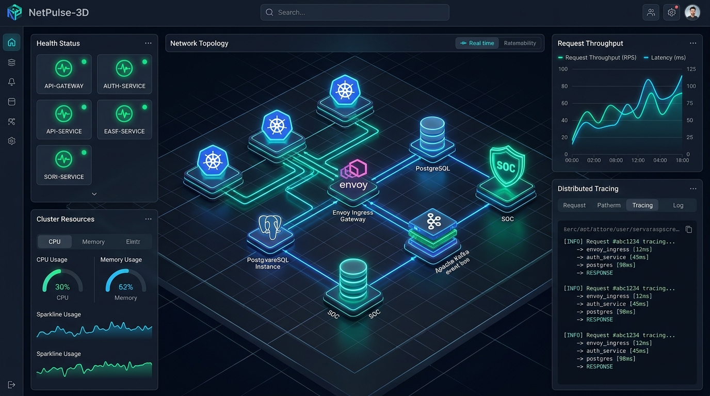
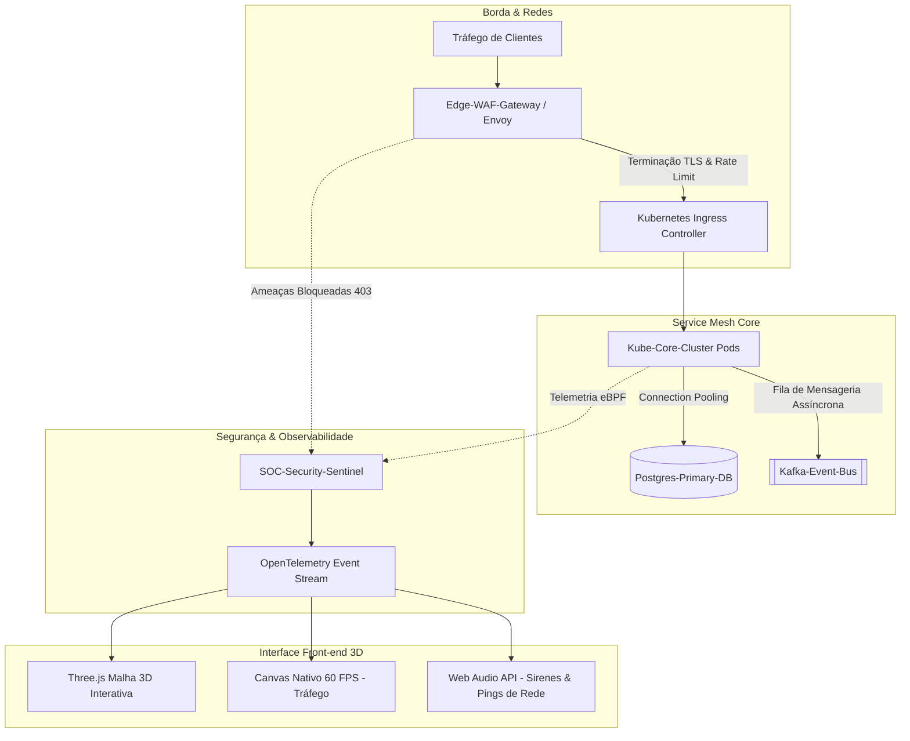

# 🌐 NetPulse-3D // Topologia de Rede Cloud & Observabilidade SRE

[](https://MarcosAosf.github.io/netpulse-3d/)
[](https://threejs.org/)
[](https://developer.mozilla.org/)
[](https://opentelemetry.io/)
[](LICENSE)

> **Cockpit de observabilidade SRE e visualizador 3D em tempo real para topologias de rede em nuvem, microsserviços Kubernetes e telemetria de segurança SOC.**  
> *Construído com renderização WebGL em Three.js, motor de gráficos Canvas nativo a 60 FPS, sintetizador de áudio procedural (Web Audio API) e arquitetura modular ES6 sem necessidade de compilação ou dependências externas.*

---

## 📸 Demonstração Visual e Prévia da Interface



```
┌────────────────────────────────────────────────────────────────────────────────────────┐
│  NETPULSE-3D  │ STATUS: SAUDÁVEL (99.98%) │ VAZÃO: 1.420 req/s │ P95: 2.4ms │ SOC: 14  │
├──────────────────────────┬───────────────────────────────┬─────────────────────────────┤
│ TOPOLOGIA 3D DO CLUSTER  │ MOTOR DE VAZÃO & LATÊNCIA     │ SPANS OPENTELEMETRY AO VIVO │
│                          │                               │                             │
│   [ Three.js WebGL ]     │      [ Canvas 60 FPS ]        │ [14:35:10] Ingress ➔ Kube:  │
│      Nó Central K8s      │  Curva Dinâmica de Throughput │ >> GET /api/v1/auth (1.8ms) │
│       /\        /\       │    Vazão (req/s) e Latência   │                             │
│      /  \      /  \      │                               │ [14:35:12] WAF ➔ SOC:       │
│  Ingress  DB   Kafka     │───────────────────────────────│ >> 403_BLOCKED (SQLi Drop)  │
│                          │ FEED DE INCIDENTES SRE        │                             │
│ ──────────────────────── │ [OK] K8s HPA: 24 Réplicas     │ [14:35:14] Kube ➔ Kafka:    │
│ Pods: 24/24 | eBPF: OK   │ [AVISO] Memória DB em 78%     │ >> Evento de auditoria      │
└──────────────────────────┴───────────────────────────────┴─────────────────────────────┘
```

---

## 🏛️ Arquitetura de Engenharia de TI



---

## ⚡ Principais Capacidades Técnicas

1. **Topologia 3D de Service Mesh (Three.js WebGL):**
   - Nós tridimensionais interativos representando: Gateway de Borda (Ingress), Cluster Kubernetes Central, Banco de Dados Relacional, Barramento Kafka e Sentinela de Segurança SOC.
   - Detecção com Raycasting: passe o mouse ou clique em qualquer nó para inspecionar métricas isoladas e disparar pulsos de telemetria.
   - Partículas dinâmicas simulando o tráfego contínuo de pacotes de dados na malha de rede.

2. **Gráfico de Vazão em Canvas Nativo a 60 FPS:**
   - Visualizador de Throughput (Requisições por Segundo) e Latência P95/P99 em tempo real com gradiente neon sem uso de bibliotecas externas pesadas.

3. **Rastreamento Distribuído OpenTelemetry:**
   - Fluxo ao vivo de spans (HTTP/2, gRPC, consultas SQL e eventos Kafka) com tempos de resposta, tamanho de payload e status code.
   - Filtros dinâmicos e modal interativo para inspeção profunda de payloads JSON.

4. **Sintetizador de Áudio Procedural (Web Audio API):**
   - Gera bips de pacotes de rede e sirenes sonoras de alerta de segurança em tempo real diretamente via código, sem necessidade de arquivos `.mp3` ou `.wav` externos.

5. **Arquitetura Web Limpa (Zero Build Step):**
   - Funciona imediatamente ao abrir o arquivo `index.html` ou ao ser publicado diretamente no **GitHub Pages**.

---

## 💻 Execução Local Imediata

Como o **NetPulse-3D** utiliza módulos nativos ES6 sem dependências de compilação:

```bash
# Clone o repositório
git clone https://github.com/MarcosAosf/netpulse-3d.git
cd netpulse-3d

# Inicie com o servidor HTTP nativo do Python
python -m http.server 8080
```
Abra seu navegador em: `http://localhost:8080`

---

## 🌐 Deploy no GitHub Pages (Passo a Passo)

1. Envie o repositório para o seu GitHub.
2. Acesse a aba **Settings** ➔ **Pages** no seu repositório.
3. Em **Branch**, selecione `main` e `/ (root)`.
4. Clique em **Save**.
5. O seu cockpit estará no ar em:  
   👉 **`https://MarcosAosf.github.io/netpulse-3d/`**

---

## 👤 Autor & Contato

**Marcos A.**  
*Engenheiro de Software & Infraestrutura | Redes, Cloud & DevOps*  
- **GitHub:** [@MarcosAosf](https://github.com/MarcosAosf)

---
*Distribuído sob a Licença MIT.*
